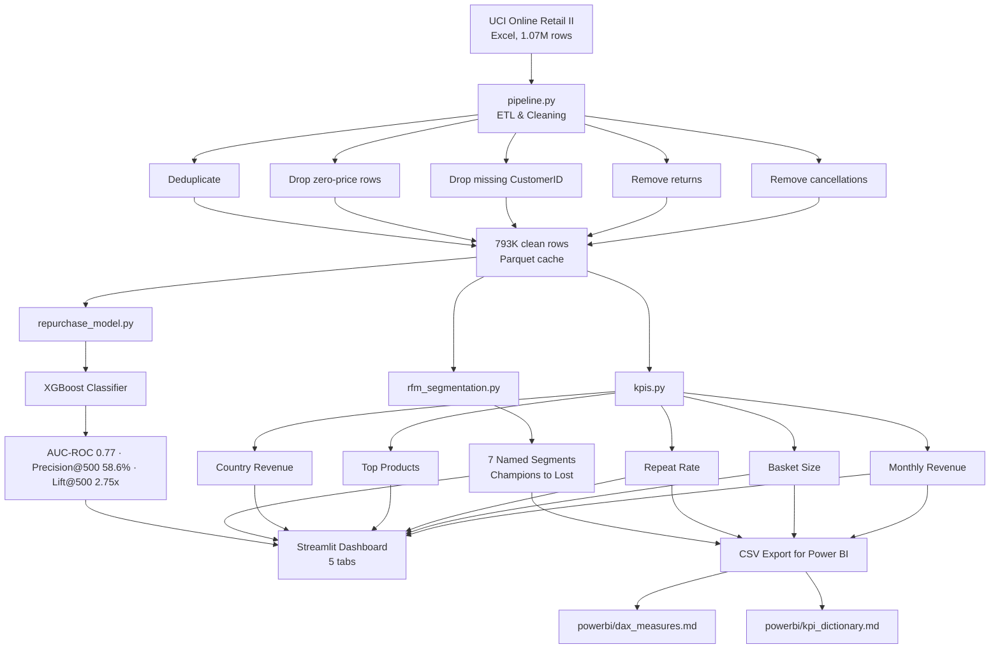
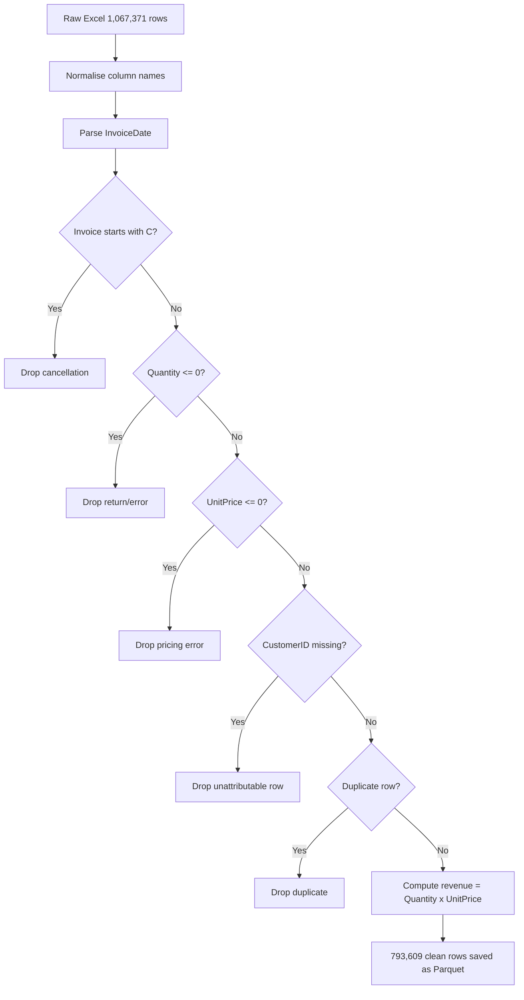
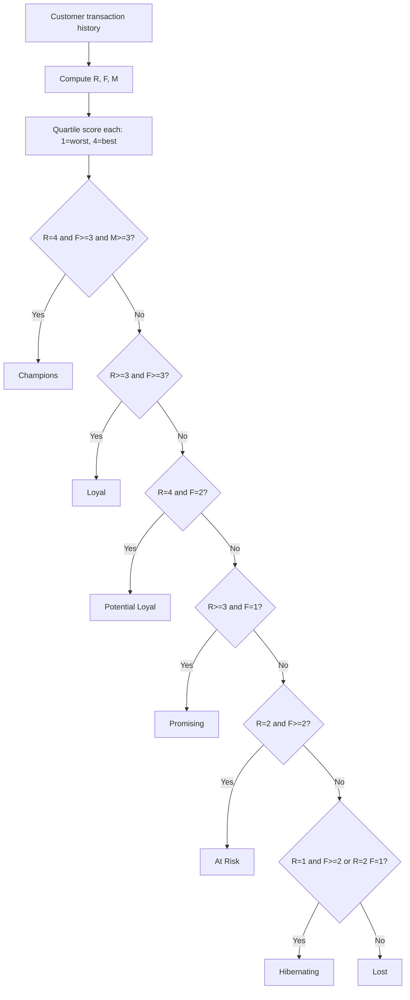

# Retail Growth Intelligence


> **Portfolio project** — end-to-end retail analytics on [UCI Online Retail II](https://archive.ics.uci.edu/dataset/502/online+retail+ii).
> All results characterise this **public dataset** only. Not attributable to any real business.

---

## What this is

A production-style retail analytics pipeline covering the full stack from raw transaction data to a customer-facing dashboard and a machine-learning propensity model: ETL cleaning → RFM segmentation → monthly KPI reporting → 30-day repurchase prediction. Includes Power BI DAX measures and a KPI dictionary for BI reporting.

---

## Live results

| Metric | Value |
|---|---|
| Raw transactions | 1,067,371 |
| After cleaning | **793,609** (74.4% retained) |
| Unique customers | ~5,900 |
| Total revenue (2 years) | £9.7M |
| Champions + Loyal revenue share | ~65% |
| At Risk + Hibernating customers | ~900 |
| Repurchase model AUC-ROC | **0.77** |
| **Precision@500** | **58.6%** |
| **Lift@500** | **2.75×** baseline |
| Baseline repeat rate | 21.3% |

---

## Architecture



---

## ETL pipeline



---

## RFM segmentation rules



---

## Project structure

```
retail-growth-intel/
├── app.py                  # Streamlit dashboard (5 tabs)
├── src/
│   ├── pipeline.py          # Download UCI Excel + ETL cleaning
│   ├── rfm_segmentation.py  # RFM scoring + 7 segment rules
│   ├── kpis.py              # Revenue, basket, repeat rate, returns
│   └── repurchase_model.py  # Feature engineering + XGBoost + P@K
├── powerbi/
│   ├── dax_measures.md      # Paste-ready DAX measures
│   └── kpi_dictionary.md    # Metric definitions + segment rules
└── data/                    # Downloaded on first run (gitignored)
```

---

## Run locally

```bash
git clone https://github.com/AchintyaCodes/retail-growth-intel
cd retail-growth-intel
pip install -r requirements.txt
streamlit run app.py
# Downloads UCI dataset (~45 MB) and cleans it on first run (~30 s)
# Parquet cache used on subsequent runs (~1 s)
```

---

## Tech stack

| Layer | Library / Tool | Purpose |
|---|---|---|
| Data ingestion | `requests`, `openpyxl` | Download + read UCI Excel |
| ETL | `pandas` | Cleaning, dedup, feature engineering |
| Segmentation | `pandas` (quartile cuts) | RFM scoring + rule-based segments |
| ML model | `xgboost`, `scikit-learn` | 30-day repurchase propensity |
| Cache | `pyarrow` Parquet | Skip 20-second Excel parse on re-runs |
| Dashboard | `streamlit`, `plotly` | 5-tab interactive app |
| BI assets | Markdown DAX | Power BI Desktop import |

---

## Resume bullet

> Built a Python ETL pipeline cleaning **793K** retail transactions and a Power BI dashboard on revenue, basket size, repeat rate and segment trends. A 30-day repurchase XGBoost model reached **58.6% precision on the top 500 customers** — **2.75× the baseline repeat rate**.

---

*Built by [Achintya Gupta](https://github.com/AchintyaCodes) · Data Science & Engineering, MIT Manipal*
